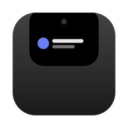

<p align="center">
  
</p>

<h1 align="center">Notchcord</h1>

<p align="center">
  Your Discord channels, living in the MacBook notch.<br>
  A tiny native macOS app that turns the notch into a Dynamic Island for up to four Discord channels.
</p>

---

## Features

- **Lives in the notch.** Hover the notch and the island drops down with your channel. Move away and it tucks itself back in.
- **Keep it open.** Pin the island so it stays expanded while you work.
- **Floating window.** Detach it into a small always-on-top window you can drag to any corner and resize.
- **Up to 4 channels.** Switch with tabs, or show **two channels side by side**.
- **Live previews.** When a message arrives in any of your channels, the island briefly expands with the author, the text and who they're replying to. Unread counts show up beside the notch.
- **Read and reply.** It's the real Discord client, so you can type, react, open threads and upload files.
- **Global shortcut.** <kbd>⌃</kbd> <kbd>⌥</kbd> <kbd>D</kbd> opens the island with the message box focused.
- **Menu bar app.** No Dock icon. Optional *Open at login*.
- **English and Brazilian Portuguese.** The interface follows your macOS language.
- Works on Macs without a notch too: the island hangs from the top center of the screen.

## How it works

Notchcord loads **discord.com** in a `WKWebView`, logged in with your own account, the same way Safari does. It only adds a compact stylesheet (hiding the server list, member list and title bar) and a small observer that reads new messages already on the page to show previews.

- No bot, no API token, no self-bot, no automation. You type every message yourself.
- Your session is stored only on your Mac, in the app's own WebKit storage.
- Notchcord makes no network requests other than the Discord web client itself, and has no analytics.

> **Heads-up:** Discord's Terms of Service discourage modified clients. Notchcord does not automate anything and only restyles the official web client, but you use it at your own risk.

## Install

1. Download `Notchcord.zip` from the [latest release](../../releases/latest) and unzip it.
2. Move `Notchcord.app` to `/Applications`.
3. The app is not notarized, so on the first launch macOS will block it. Either right-click the app → **Open** → **Open**, or run:
   ```sh
   xattr -dr com.apple.quarantine /Applications/Notchcord.app
   ```
4. Log in to Discord in the window that opens (the QR code works), browse to a channel and click **Use this channel**.

Requires macOS 14 Sonoma or later (Apple silicon or Intel).

## Usage

| Action | How |
| --- | --- |
| Open the island | Hover the notch, or press <kbd>⌃</kbd><kbd>⌥</kbd><kbd>D</kbd> |
| Keep it open | Pin button in the island, or the menu bar icon → *Keep open* |
| Add a channel | **+** in the island, or menu bar icon → *Add channel…* |
| Two channels at once | Split button (shows up with 2+ channels) |
| Floating window | Detach button in the island. Drag it by the top bar and resize from the corner |
| Resize the island | Drag the grip in the bottom-right corner |
| Text size | **⋯** menu → Larger / Smaller text |
| Remove a channel | Right-click its tab, or the **⋯** menu |

## Build from source

Requires Xcode 15+ (Swift 5.10).

```sh
git clone https://github.com/carlossantos-br/notchcord.git
cd notchcord
./build.sh --install --open      # universal release build, installs to /Applications
```

Other options:

```sh
./build.sh --debug --install     # enables the Web Inspector and a local debug bridge
./build.sh --zip                 # creates build/Notchcord.zip
```

### Project layout

| File | What it does |
| --- | --- |
| `Island.swift` | The non-activating panel, notch geometry, hover/pin/floating logic and message previews |
| `IslandView.swift` | SwiftUI island: notch shape, tabs, controls, preview, resize grip, web view stage |
| `DiscordWeb.swift` | One `WKWebView` per channel, shared login, navigation rules |
| `InjectedScripts.swift` | Compact CSS and the new-message observer injected into Discord |
| `Picker.swift` | Full Discord window used to log in and pick channels |
| `App.swift` | Menu bar menu, global hotkey, app delegate |
| `L10n.swift` | English / Brazilian Portuguese strings |

Discord ships hashed class names (`guilds_a4d4d9`), so the stylesheet matches class prefixes. If an update breaks the compact layout, `InjectedScripts.swift` is the place to look. PRs are welcome.

## Disclaimer

Notchcord is an independent project and is not affiliated with, endorsed by or sponsored by Discord Inc. "Discord" is a trademark of Discord Inc.

## License

[MIT](LICENSE)
